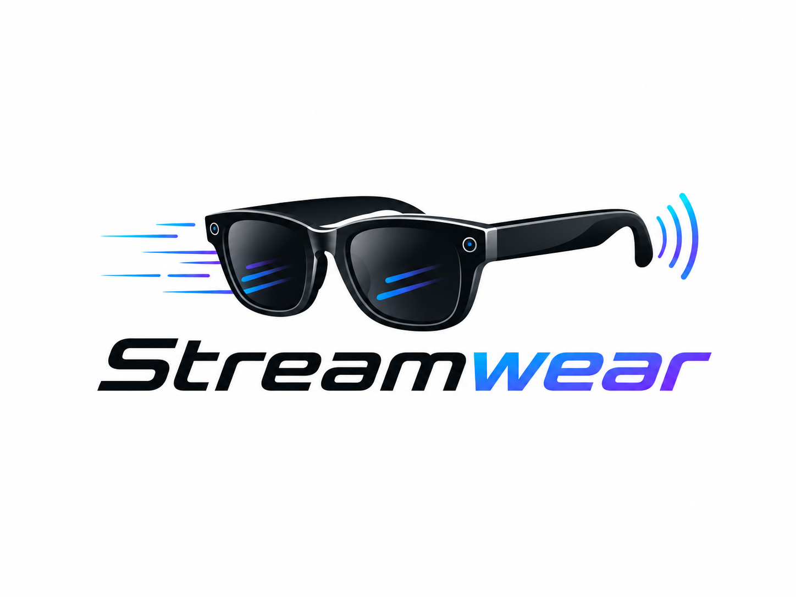

  

<h1 align="center">Streamwears</h1>

<strong>Go live from your glasses.</strong> Share what you see. Keep your hands free.

  <a href="https://testflight.apple.com/join/Ee36dYF9"><strong>Get the glasses version on TestFlight</strong></a>

  <a href="https://streamwearsirl.com">Website</a> ·
  <a href="docs/releases/README.md">Release notes</a> ·
  <a href="https://streamwearsirl.com/support">Support</a> ·
  <a href="https://github.com/issaghostlife/streamwears/issues">Feedback</a>

## Your glasses. Your perspective. Live.

Streamwears turns compatible Meta smart glasses into a camera for your live broadcast. Preview the view from your glasses, choose where to stream and bring your audience along while keeping your hands free.

The **glasses version for iPhone is available through TestFlight**. Install Apple’s TestFlight app, open the invitation above and install Streamwears. TestFlight shows the builds currently available to your account and delivers beta updates.

## One view, more audiences

- Stream to **up to three enabled destinations at once, free**.
- Choose where each broadcast goes.
- Check your camera and sound before going live.
- Follow supported platform chat and broadcast status in Studio.
- Keep camera, audio and destination controls together.

Compatibility, Meta access, permissions and each platform’s live-streaming eligibility apply. Beta features and availability can change.

## Your first stream

1. **Install the glasses version** from [TestFlight](https://testflight.apple.com/join/Ee36dYF9).
2. Pair your compatible glasses with your iPhone in Meta AI, then follow the connection and camera-access prompts in Streamwears.
3. Connect your streaming accounts and choose your live destinations.
4. Tap **Start preview**, check the glasses picture and audio, then tap **Go live**.
5. Tap **End live** when you finish.

## Also on the App Store: iPhone camera only

Want to stream from your phone? The separate **App Store edition uses your iPhone’s front or rear camera**. It also supports up to three enabled destinations at once for free, with optional Full Access for unlimited simultaneous destinations.

**[Download the iPhone-camera edition on the App Store](https://apps.apple.com/app/id6815077840)**

For glasses streaming, use the TestFlight version linked at the top of this page.

## Updates and help

- [Release notes and version archive](docs/releases/README.md)
- [Android release archive](docs/releases/android/README.md)
- [Setup and troubleshooting](SUPPORT.md)
- [Contact support](https://streamwearsirl.com/support)
- [Feedback and bug reports](https://github.com/issaghostlife/streamwears/issues)
- [Privacy policy](https://streamwearsirl.com/privacy)
- [Report a security issue privately](SECURITY.md)

For feedback, include your device, app version and what happened. Keep passwords, access tokens and stream keys private.

## About this repository

**Streamwears is closed source.** This repository contains public product information, release notes and support resources. The app’s private source code is not published here.

Streamwears is independent and is not affiliated with or endorsed by Meta, Apple or the supported streaming platforms.

© 2026 Streamwears. All rights reserved.

