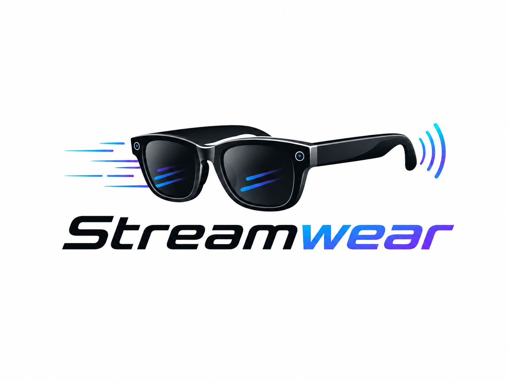

  

<h1 align="center">StreamwearsIRL</h1>

Your view. Live. Livestream from your phone or compatible Meta smart glasses.

  <a href="https://testflight.apple.com/join/Ee36dYF9"><strong>Download for iPhone</strong></a> ·
  <a href="https://github.com/issaghostlife/streamwears/releases/download/android-v3.7/Streamwears.apk"><strong>Download for Android</strong></a> ·
  <a href="https://streamwearsirl.com"><strong>Website</strong></a> ·
  <a href="https://streamwearsirl.com/support"><strong>Support</strong></a>

## Download the app

| Device | Download | Availability |
| --- | --- | --- |
| iPhone / iOS | [Join the Apple TestFlight beta](https://testflight.apple.com/join/Ee36dYF9) | Apple-approved TestFlight beta; current release: **3.0 (24)** |
| Android 12 or newer | [Download the signed Android 3.7 APK](https://github.com/issaghostlife/streamwears/releases/download/android-v3.7/Streamwears.apk) · [Release notes](https://github.com/issaghostlife/streamwears/releases/tag/android-v3.7) | Android beta; real-device and glasses testing is ongoing |
| App Store | Not available yet | Updates will be announced here and on our website |

**On iPhone:** install Apple's TestFlight app, open the beta invitation above, then install StreamwearsIRL. Keep TestFlight installed to receive beta updates.

**On Android:** download the APK on your phone, open it and follow Android's installation prompts. If Android asks, allow your chosen browser or file manager to install this download. Future updates should be installed over the existing app to retain its saved connections.

### Latest iPhone TestFlight update — 3.0 (24)

Build 24 fixes Blayzer / RB Meta 00FQ preview startup and adds one-tap crowdfunding:

- Streamwears accepts the current glasses Device Access Toolkit 1.0.0 with the app's Meta iOS SDK 1.0.1 instead of sending a fully updated tester back to Developer Settings.
- Camera access shown as **Allowed** remains authorized while Streamwears follows the glasses' actual device-link, wear and hinge state.
- Preview starts with full-quality HEVC. If Meta reports streaming but sends no frame, Streamwears performs one clean retry through Meta's official raw medium-resolution 24 fps camera configuration. A Meta-reported 1.0.x device mismatch begins on that compatibility path immediately.
- The app reports connected only after receiving a real video frame and exits the connecting state if neither attempt produces one.
- Glasses remain off after deep sleep, charging or returning to the app until the user taps **Start Preview**; protected reconnect continues only during an active broadcast.
- Settings now includes **Crowdfund Streamwears** below King Coop, opening the secure Square contribution page in one tap.

[Read the complete 3.0 (24) release and tester notes](RELEASE_NOTES_3.0_24.md).

### Android glasses setup — 3.7 Developer Mode build

The Android APK now uses Meta's supported Developer Mode connection. **You do not need a Streamwears tester invitation for this Android build.** The 100-user channel limit applies to registered-channel testing, not this Developer Mode setup. This is a development/testing connection, not Meta public-production approval.

1. Update Meta AI and the glasses, then pair the glasses in Meta AI.
2. In Meta AI, open **Settings → App info** and enable **Developer Mode**. If hidden, tap **App version five times**. This is inside Meta AI, not Android phone Developer options or USB debugging.
3. With the glasses connected, check the **Device Access Toolkit** app and install/update it if Meta AI requests it. Wait for installation to finish.
4. Return to Streamwears, tap **Connect Meta glasses**, approve registration and camera access, then start preview.
5. Connect a streaming account and start a test broadcast after actual preview frames appear.

If an older connection is stale, disconnect Streamwears in Meta AI and reconnect. Keep the Android app installed to retain saved streaming accounts. Developer Mode can reset after updates. [Meta's Android setup guidance](https://github.com/facebook/meta-wearables-dat-android/issues/214) · [Android 3.7 notes](ANDROID_3.7.md).

Android retains YouTube/Instagram account connection, manual Instagram fallback, AI help, Latin Live Text/translation, TikTok chat/gifts, and update alerts. Physical glasses and live-provider performance still need device validation.

### Android 3.7 interface update

Studio, Destinations, AI, Live and Settings now follow the iPhone layout with a dark background, mint controls, rounded cards and floating navigation. Studio includes preview controls and destination selection. AI can take or choose a photo for local image labels and Latin text recognition, translate text, and use Android speech input when available. Ask uses the online Streamwears service; Android does not include Apple’s on-device AI. [Android 3.7 details](ANDROID_3.7.md).

### Android update alerts

Install Android **3.3 or later once**, then allow notifications. The app checks for new releases when opened and about hourly in the background. Tap **Update available** to download the APK, then confirm installation over the existing app. You can also use **Settings → App updates → Check for updates**.

Checks pause during a LIVE. Android power management and offline phones can delay alerts. Older APKs need this initial update before they can notify you. [Android release publishing guide](ANDROID-RELEASES.md).

### TestFlight, Meta glasses and the App Store

Our iOS beta has been approved for distribution through **Apple TestFlight**. This is beta approval; StreamwearsIRL is not on the App Store yet.

Meta glasses features are available in our iOS TestFlight beta. Meta has not yet granted the production access we need to include those features in our App Store release. We cannot ship App Store glasses functionality until that access is available.

We are working toward an App Store version that people can use **without Meta glasses**, using their phone camera. We will announce when it is available. For Meta glasses streaming on iPhone now, use the TestFlight beta linked above.

## Connect, log in and go live

StreamwearsIRL connects to your streaming accounts so you can get on with your stream.

### Automatic Instagram Live

The iPhone 3.0 beta and Android 3.7 connect Instagram Live without copying a stream URL or stream key. Sign in once, approve Instagram's connection request, and future broadcasts request fresh RTMPS credentials automatically when you tap **Go live**. TikTok LIVE also connects without a pasted stream key and brings chat, events and gifts into Studio.

Connected channels now appear together in Creator Progress. When Live discovery is enabled, active streams show the creator's connected username so viewers know who is live.

| Platform | How you connect |
| --- | --- |
| TikTok | Log in and authorize the Streamlabs connection; no manual stream key |
| Facebook Live | Log in and authorize your account; no manual stream key |
| Kick | Log in and authorize your account; no manual stream key |
| Twitch | Log in and authorize your account; no manual stream key |
| Instagram Live on iPhone | Sign in once for automatic Live setup; no pasted stream key or Safari step |
| Instagram Live on Android 3.7 | Sign in and approve the connection; automatic Live setup, with manual URL/key fallback in Destinations |
| YouTube on Android 3.7 | Sign in and authorize; automatic broadcast preparation |

Your account must be eligible to go LIVE on the selected platform. Automatic Instagram setup is available in the iPhone TestFlight beta and Android 3.7. Manual Instagram URL/key setup remains available as a fallback: **Settings → Stream keys** on iPhone, or the Instagram card in **Destinations** on Android.

## Your first stream

1. **Install the app** using the iPhone or Android link above.
2. **Choose your camera.** Use your phone's front/rear camera, or compatible Meta glasses. For Android glasses, follow the Developer Mode setup above; then connect and approve permissions. iPhone registered-beta access follows its Meta invitation setup.
3. **Connect a platform** from the account/destination screen. Sign in, approve access and return to the app. TikTok uses the Streamlabs sign-in flow.
4. **Prepare your LIVE.** Select the accounts you want to stream to and add a title/category when requested.
5. **Start preview**, check your picture and audio, then tap **Go live**.
6. For Facebook, use **Choose Facebook profile or Page** on its account card when you want to change the destination. An automatically connected Instagram account needs no extra Live Producer step. Manual Instagram destinations still require Go live and End in Live Producer.
7. Follow comments and connection status in the app. Tap **End live** when you finish.

No glasses? Use your phone camera. Valid saved account sessions are reused; you only need to reconnect when a provider requires fresh authorization.

## Keep your stream light and stable

- Start with **720p**. Lower the quality if your upload connection is struggling.
- Enable only the destinations you plan to use; each additional destination uses more upload data.
- Close other apps that are using the camera or microphone.
- Keep your phone cool and charged, and keep Bluetooth enabled when using glasses.
- Expect cellular handoffs, weak signal and device temperature to affect video quality and latency.

## About this repository

**StreamwearsIRL is a closed-source app.** This public repository contains downloads, release information, user guides and support resources. The application source code is not published here. GitHub's automatically generated “Source code” ZIP/TAR links contain this public repository's documentation and assets, not the app's private source.

StreamwearsIRL is an independent app and is not affiliated with or endorsed by Meta, Apple, Ray-Ban or the streaming platforms. TestFlight distribution does not imply an endorsement.

## Help, feedback and updates

- [Official website](https://streamwearsirl.com)
- [Support and troubleshooting](SUPPORT.md) · [Contact support](https://streamwearsirl.com/support)
- [Report a bug](https://github.com/issaghostlife/streamwears/issues/new)
- [Releases and download notes](https://github.com/issaghostlife/streamwears/releases)
- [Privacy](PRIVACY.md) · [Official privacy policy](https://streamwearsirl.com/privacy)
- [Report a security issue privately](SECURITY.md)

For a bug report, include your phone, OS/app version, glasses model if applicable, streaming platform and what happened. Never post passwords, access tokens, stream keys or signing credentials in public issues.

© 2026 StreamwearsIRL. All rights reserved.

