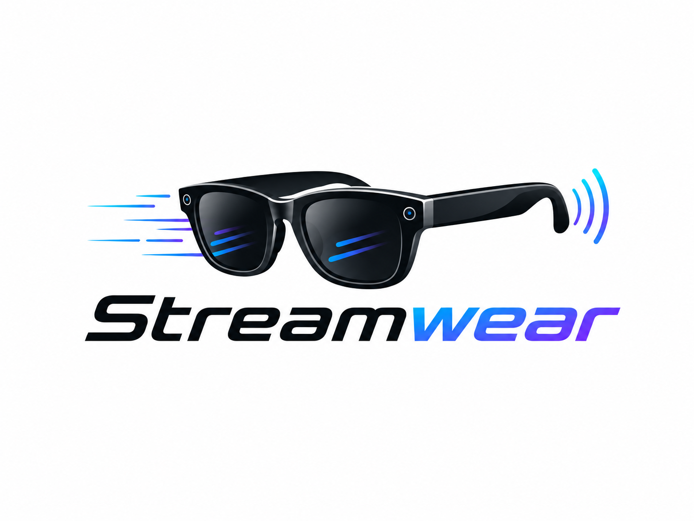

  

<h1 align="center">Streamwears</h1>

<strong>Go live from your glasses.</strong> Share what you see. Keep your hands free.

  <a href="https://apps.apple.com/app/id6815077840"><strong>Download on the App Store</strong></a> ·
  <a href="https://testflight.apple.com/join/Ee36dYF9">Join the TestFlight beta</a>

  <a href="https://streamwearsirl.com">Website</a> ·
  <a href="https://streamwearsirl.com/Metaapps/">App directory</a> ·
  <a href="docs/releases/README.md">Release notes</a> ·
  <a href="https://streamwearsirl.com/support">Support</a> ·
  <a href="https://github.com/issaghostlife/streamwears/issues">Feedback</a>

## Your glasses. Your perspective. Live.

Streamwears turns compatible Meta smart glasses into a camera for your live broadcast. Preview the view from your glasses, choose where to stream and bring your audience along while keeping your hands free.

**Streamwears 3.4 on the App Store supports compatible Meta glasses and your iPhone’s front or rear camera.** Pair your glasses through Meta AI on the same iPhone, then connect them in Streamwears. TestFlight remains available for beta updates.

## One view, more audiences

- Stream to **up to three enabled destinations at once, free**.
- Choose where each broadcast goes.
- Check your camera and sound before going live.
- Follow supported platform chat and broadcast status in Studio.
- Keep camera, audio and destination controls together.

Compatibility, Meta access, permissions and each platform’s live-streaming eligibility apply. Beta features and availability can change.

## Your first stream

1. **Install Streamwears** from the [App Store](https://apps.apple.com/app/id6815077840).
2. Pair your compatible glasses with your iPhone in Meta AI, then follow the connection and camera-access prompts in Streamwears.
3. Connect your streaming accounts and choose your live destinations.
4. Tap **Start preview**, check the glasses picture and audio, then tap **Go live**.
5. Tap **End live** when you finish.

## Submit an app to Streamwears Apps

Building an app for smart glasses? Open [Streamwears Apps](https://streamwearsirl.com/Metaapps/) and select **Submit an app**. Paste your App Store, TestFlight, Google Play, or GitHub link and submit the listing for review. Track your submission and manage approved listings in the [developer dashboard](https://streamwearsirl.com/Metaapps/dev/).

## Updates and help

- [Release notes and version archive](docs/releases/README.md)
- [Android release archive](docs/releases/android/README.md)
- [Setup and troubleshooting](SUPPORT.md)
- [Contact support](https://streamwearsirl.com/support)
- [Feedback and bug reports](https://github.com/issaghostlife/streamwears/issues)
- [Privacy policy](https://streamwearsirl.com/privacy)
- [Report a security issue privately](SECURITY.md)

For feedback, include your device, app version and what happened. Keep passwords, access tokens and stream keys private.

## About this repository

**Streamwears is closed source.** This repository contains public product information, release notes and support resources. The app’s private source code is not published here.

Streamwears is independent and is not affiliated with or endorsed by Meta, Apple or the supported streaming platforms.

© 2026 Streamwears. All rights reserved.

